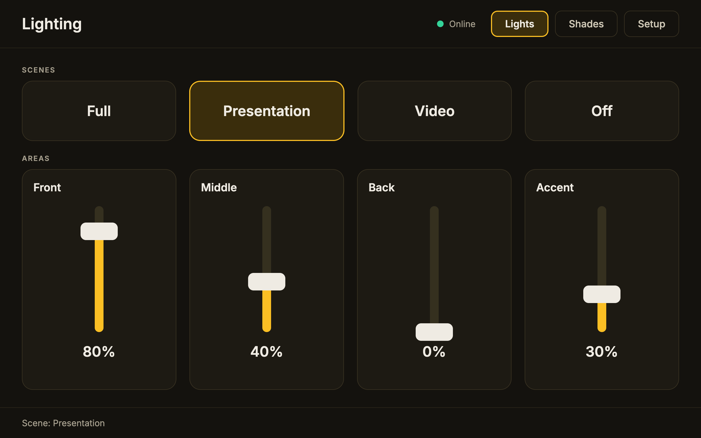
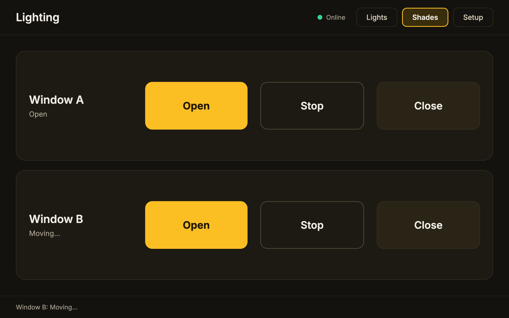

# Q-SYS Lighting & Shades Panel (Lua sample project)

# Images

A third Q-SYS sample: a touchscreen panel for four lighting areas, four scenes, and two motorized shades,
with a UDP lighting driver and an HTTP shade driver.

## Features

- 4 lighting areas with 0-100% faders
- 4 scenes (Full, Presentation, Video, Off) with a longer fade time and active-scene indicators
- Fader throttling so the lighting processor is never flooded with commands
- 2 shades with Open / Stop / Close and a status readout
- UDP heartbeat that drives an Online indicator

## Files

| Path | Purpose |
|------|---------|
| `src/lighting_control.lua` | Everything: scenes, throttled faders, UDP lighting driver, HTTP shade driver, heartbeat |
| `docs/uci_layout.md` | UCI build guide (three pages) and a hardware-free test procedure |

## Concepts demonstrated

- `UdpSocket` for sending commands and receiving replies
- `HttpClient.Download` with a response handler for success and error cases
- Throttling high-rate control events with a dirty flag and a flush timer
- Scene recall that bypasses the throttle, with a guard flag so scenes don't clear their own indicators
- A heartbeat with a reply timeout to derive a connection state over a connectionless protocol
- Arrayed controls with closures in loops

## Quick start

1. Install Q-SYS Designer (free; Emulate mode needs no hardware).
2. Follow `docs/uci_layout.md` to add the Script component, control pins and UCI.
3. Paste `src/lighting_control.lua`.
4. Press F5, open the UCI viewer, and test against a UDP listener (see the guide).

## Make it yours

The command formats are placeholders. Edit `levelCommand` and `PING_COMMAND` for the lights, and the `url`
in `shadeRequest` for the shades, to match your hardware. Area and scene names live in the config tables at
the top of the script.

## Status

Sample code, untested on a Core. Check API names (`UdpSocket`, `HttpClient.Download`) against your Designer
version's Lua reference.

## License

MIT
